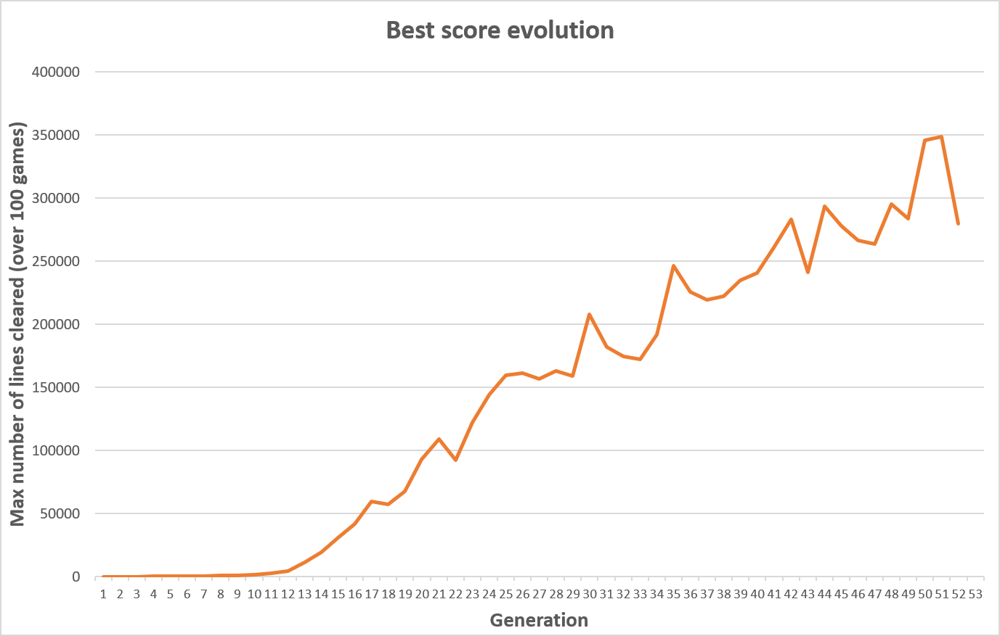

[🇫🇷 Français](README.fr.md) | [🇬🇧 English](README.md)

# Tetris AI Trained with a Genetic Algorithm

A Tetris bot written in OCaml whose behaviour is controlled by 20 weights optimized by a genetic algorithm.

The best individual clears approximately **348,500 lines per game on average** on a 10 × 16 board with uniformly random pieces and no next-piece preview.

A random bot clears fewer than one line per game.

## 1. Context and Rules

The goal is to test how far a simple, interpretable controller can go through automatic optimization, without a neural network or manual tuning. The simulator was designed to be super fast to evaluate large numbers of placements over long games.

| Rule | Setting |
|---|---|
| Board | 10 columns × 16 rows |
| Pieces | 7 standard tetrominoes, uniformly random |
| Information | Current piece only; no preview or hold |
| Placement | Vertical drop at a chosen column and rotation |
| Score | Number of lines cleared |

## 2. How the Bot Plays

For each piece, the bot evaluates every valid rotation and column, simulates the resulting board, and selects the placement with the lowest cost.

The cost is a **linear combination of 20 board features**, inspired by Dellacherie-style Tetris controllers. The features describe properties such as landing height, cleared lines, surface irregularities, holes, wells, and target height profiles.

The genetic algorithm optimizes one weight per feature. The weights remain interpretable: their signs and magnitudes indicate which board properties the bot favours or penalizes.

## 3. Genetic Algorithm

Each individual contains 20 feature weights and 20 associated mutation step sizes (`sigma`). Fitness is measured as the mean number of lines cleared over 100 games.

Because fitness evaluation is stochastic and expensive, a derivative-free, population-based optimization method is appropriate. Each generation is saved to disk so that long training runs can be resumed.

## 4. Performance Optimizations

Evaluating 100 games per individual, with strong bots surviving hundreds of thousands of pieces, makes simulation performance critical.

- **Bitset board:** pack the 160 cells into 20 bytes for inexpensive board copies.
- **Precomputation:** store piece rotations and valid column ranges.
- **Early pruning:** allocate more games to promising candidates.
- **Parallel evaluation:** distribute individuals across CPU cores using OCaml 5 domains and `Domainslib`.
- **Checkpointing:** save each generation so interrupted runs can be resumed.

## 5. Results

| Metric | Result |
|---|---:|
| Random bot | Fewer than 1 line per game |
| Best individual (generation 51) | Approximately 348,500 lines per game |
| Fitness evaluation | Mean over 100 games per individual |
| Training duration | Approximately 6 days on a laptop |



The best individual and fitness history are available in [`results/best_individual.txt`](results/best_individual.txt) and [`results/fitness_history.csv`](results/fitness_history.csv).

Fitness estimates are noisy. The strongest candidates were compared over many games to support final selection. For a more rigorous benchmark, candidates should be evaluated on shared piece sequences and the final score should be measured on separate evaluation games.

**Benchmark limitation:** the 10 × 16 board and simplified rules prevent direct comparison with results obtained under standard Tetris rules.

## 6. Limitations and Future Work

| Area | Current limitation | Possible improvement |
|---|---|---|
| Optimization method | CMA-ES was not retained or benchmarked | Compare it with the genetic algorithm using noise-aware evaluation |
| Search | The controller evaluates placements using a linear heuristic | Test lookahead or expectimax with future-piece uncertainty |
| Evaluation noise | Independent random sequences make candidate comparisons noisier | Evaluate candidates on shared piece sequences |
| Selection | Without elite selection, the best individual can be lost between generations | Re-evaluate elites and compare elitism strategies |
| Fitness cost | Late generations take 3–5 hours each | Improve simulation speed or use staged evaluation |
| Feature design | Some features are redundant or implemented in nonstandard ways | Audit features and measure each feature's contribution |
| Game model | Simplified rules limit realism and benchmark comparability | Test a standard 20-row board, 7-bag randomizer, preview, hold, and movement under overhangs |

### Implementation caveats

Some feature quirks are intentionally preserved because the trained weights depend on them. In particular, the *big holes* feature duplicates the hole count, empty columns can count as holes, mean hole height is measured from the floor, and the exponential features use positive exponents. Correcting these behaviours requires retraining the controller.

## 7. Project Structure

```text
.
├── bin/
│   └── main.ml
├── src/
│   ├── tetris.ml
│   └── genetic.ml
├── results/
│   ├── best_individual.txt
│   ├── fitness_history.csv
│   └── best_score_evolution.png
├── Makefile
├── README.fr.md
└── README.md
```

The tree above highlights the main project files; additional build and training-data files may also be present.

| File or directory | Purpose |
|---|---|
| `bin/main.ml` | Entry point and training parameters |
| `src/tetris.ml` | Board, rules, features, evaluation, and simulation |
| `src/genetic.ml` | Genetic operators, parallel evaluation, saving, and loading |
| `results/` | My training results |

## 8. Build and Run

**Requirement:** OCaml 5 or later. No other library is needed.
The program uses parallelization.

```bash
make        # build ./main
make run    # build and start training
make clean  # remove compiled files
```

### Stopping and resuming

- **Stop:** training never ends on its own. Press `Ctrl+C` when the fitness stops improving.
- **Saved data:** each generation is written to `runs/` (the `save_dir` set in `bin/main.ml`):
  - `population_gen_N.txt`: the 10 best individuals of generation `N`;
  - `data.csv`: the elite mean and the best fitness of each generation used to monitor progress.
- **Resume:** in `bin/main.ml`, set `load = Some n` to restart from generation `n` and process generation `n+1`. Keep `load = None` to start from scratch.
